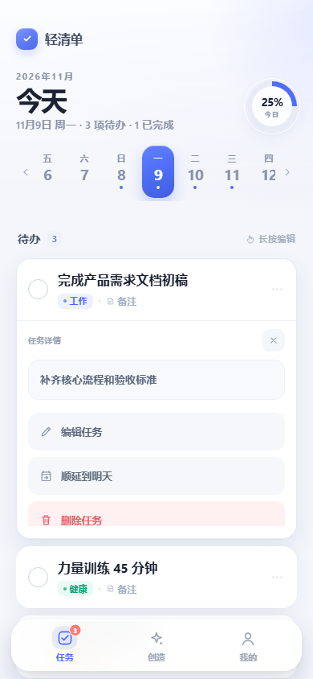
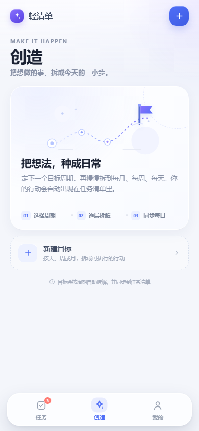
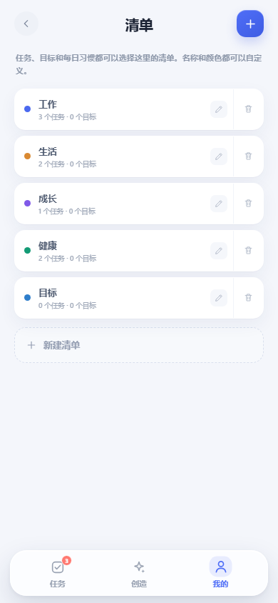

# 轻清单 · Qinglist

一个离线优先的轻量任务、目标和每日习惯管理应用。

网页端是纯 HTML / CSS / JavaScript，无框架、无构建步骤；Android 端使用 Capacitor 7 打包，安装后完全离线可用。

> 仓库地址：`https://github.com/kccQM/qinglist`  
> 下载 APK：请在 GitHub 仓库的 **Releases** 页面下载最新版本。


## 功能

### 任务

- 按日期查看待办，顶部日期条支持横向滑动。
- 新建、编辑、完成、恢复、顺延和删除任务。
- 点击任务卡在列表内原地展开详情，不再弹出底部详情层。
- 已完成任务可以删除，但不能编辑。
- 所有任务删除都需要二次确认。
- 任务可以归入自定义清单。
- 日期条圆点标记当天是否有任务。

### 目标

- 按天 / 周 / 月创建目标，支持自定义周期和开始日期。
- 自动拆解为每日行动，并同步到任务清单。
- 周计划可以增删周数，每周完成情况自动更新。
- 目标支持编辑和删除，删除时同步处理关联任务。

### 每日习惯

- 创造页右上角进入独立「每日习惯」页。
- 习惯每天自动生成一条当天任务。
- 习惯卡片本身不可勾选，完成入口统一在任务清单。
- 支持编辑、删除习惯和连续天数展示。
- 新建习惯入口固定在列表末尾。

### 清单与统计

- 清单支持新建、改名、改色和删除。
- 删除清单时，关联任务、目标和习惯会移动到其他清单。
- 至少保留一个清单。
- 统计页展示日完成度、周完成度和目标完成度。
- 字体大小可调，设置会保存在本地。

### 数据

- 数据保存在 `localStorage`，无需登录和服务器。
- 支持 JSON 导出 / 导入备份。
- 导入兼容没有清单字段的旧备份。
- 清空数据会恢复默认示例。

### 设计

- 全页面顶部安全区适配，避免内容顶到状态栏。
- 浅色状态栏背景 + 深色状态栏图标。
- 输入框聚焦不显示蓝色外框，保留内填充和内侧细描边。
- 底部表单跟随键盘上移，全屏向导按键盘高度收缩。
- 页面文字不可选择，输入框内可正常编辑。
- 更浅的蓝色品牌色和 App 图标。

## 预览

| 任务 | 原地展开详情 |
| --- | --- |
|  |  |

| 创造 | 每日习惯 |
| --- | --- |
|  |  |

| 清单 | 统计 |
| --- | --- |
|  |  |

## 技术栈

- HTML5
- CSS3（原生变量、Grid、过渡动画）
- 原生 JavaScript
- `localStorage`
- Capacitor 7
- Android SDK 35 / JDK 21

## 目录结构

```text
qinglist/
  index.html              # 网页入口
  app.js                  # 应用逻辑
  styles.css              # 样式
  serve.py                # 本地静态服务器
  preview*.png            # 预览图
  mobile/
    package.json          # Capacitor 工程
    capacitor.config.json
    assets/               # 图标和启动图源文件
    scripts/
      sync-web.js         # 同步根目录网页资源到 www
      generate-assets.py  # 生成 Android 图标
    android/              # Android 原生工程
```

## 本地运行网页

在仓库根目录：

```bash
python serve.py 8080
```

然后打开：

```text
http://localhost:8080
```

也可以使用任意静态文件服务器。

## 构建 Android APK

```bash
cd mobile
npm install
npm run cap:sync
npm run build:debug
```

发布构建需要先配置本地签名：

1. 复制 `mobile/android/keystore.properties.example` 为 `mobile/android/keystore.properties`。
2. 把你的 keystore 放到 `mobile/android/keystore/`。
3. 修改 `keystore.properties` 中的路径和密码。
4. 执行：

```bash
npm run build:release
```

生成文件：

```text
mobile/android/app/build/outputs/apk/release/app-release.apk
```

`keystore.properties`、`*.jks` 和 `*.keystore` 已在 `.gitignore` 中排除，不要提交。

## 数据与升级

- 应用数据只保存在本机浏览器或 WebView 的 `localStorage` 中。
- Android 覆盖安装不会清除应用数据。
- 卸载应用或清除应用数据会丢失本地数据，重要数据请先导出 JSON 备份。

## 版本

当前版本：`1.10.2`

当前版本说明见 [CHANGELOG.md](CHANGELOG.md)。

## 说明

- 当前仓库未自动添加开源许可证；如需公开采用，请补充 `LICENSE`。
