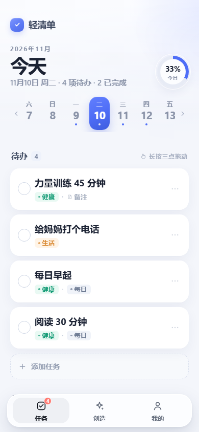
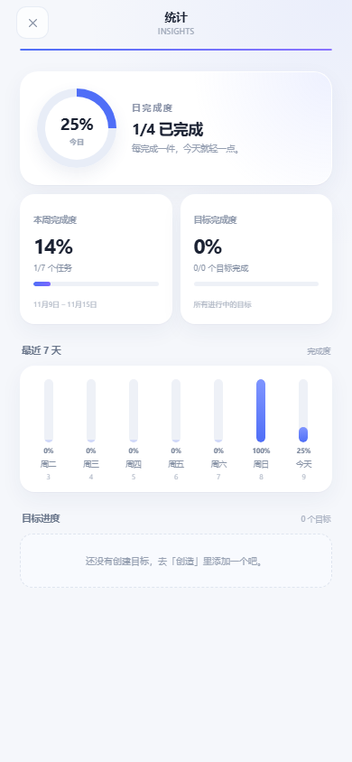
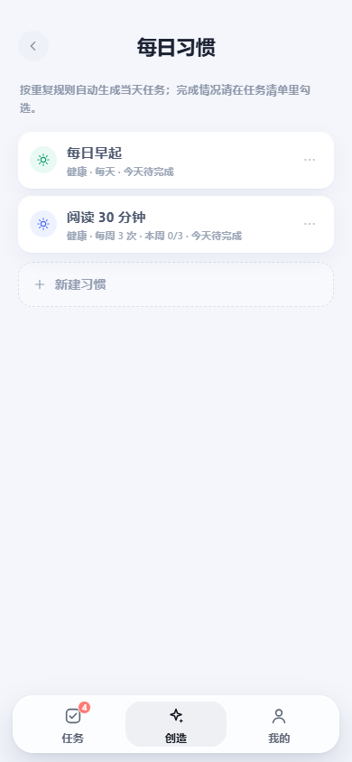
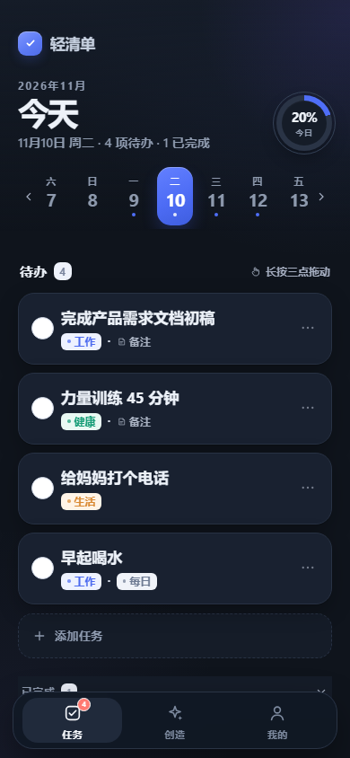

# 轻清单 · Qinglist

离线优先的任务、目标和每日习惯管理应用。

原生 HTML / CSS / JavaScript，无框架、无构建步骤；Android 由 Capacitor 7 打包，安装后完全离线可用。

[在线预览](https://kccqm.github.io/qinglist/) · [下载最新 APK](https://github.com/kccQM/qinglist/releases/latest)



## 功能

- **任务**：按日期查看、逾期顺延、原地展开详情、子任务、拖动排序。
- **目标**：按天 / 周 / 月创建，自动拆解并同步到任务清单。
- **每日习惯**：每天 / 每周 / 每月重复，自动生成当天任务；今天不需要重复的习惯自动折叠。
- **清单与搜索**：清单分类、全局搜索、搜索结果多选 / 全选 / 批量删除。
- **统计**：日、本周、目标、习惯完成度，均支持二级详情。
- **其他**：底部菜单和页面左右滑动、深色模式、字体大小、使用说明、JSON 备份、回收站撤销。

## 预览

| 任务 | 统计 |
| --- | --- |
|  |  |

| 每日习惯 | 深色模式 |
| --- | --- |
|  |  |

## 本地运行

```bash
python serve.py 8080
```

打开 `http://localhost:8080`。

## 构建 Android

```bash
cd mobile
npm install
npm run cap:sync
npm run build:debug
```

发布构建需要配置本地签名，参考 `mobile/android/keystore.properties.example`。签名文件已加入 `.gitignore`。

## 数据

数据保存在本机 `localStorage`，支持 JSON 导出 / 导入备份。覆盖安装不会清除数据。

## 版本

当前版本：`1.13.10`。版本说明见 [CHANGELOG.md](CHANGELOG.md)。
